Link del repositorio: https://github.com/jumadi13/st-2026-2-trabajo1-STVQNQ

# Alcance y procedencia

Este informe analiza los tres CSV asignados al equipo STVQNQ. Los archivos originales se conservan sin alterar, eliminar ni imputar observaciones. El horizonte final de decisión es de seis meses para la cartera, cuatro trimestres para las primas y siete días para los rechazos.

El flujo `source("analisis/correr-todo.R")` debe ejecutarse desde la raíz antes de renderizar. Las tablas de pronóstico se calculan con parámetros escogidos exclusivamente en el primer 80 % y evaluación por orígenes móviles. La banda de pronóstico se declara heurística.

```{r}
config <- list(
  list(freq="mensual",H=6,nombre="Cartera de crédito",unidad="millones de pesos",s=12),
  list(freq="trimestral",H=4,nombre="Primas emitidas",unidad="miles de millones de pesos",s=4),
  list(freq="diaria",H=7,nombre="Transacciones rechazadas",unidad="transacciones por día",s=7)
)
datos <- lapply(1:3,function(i) read.csv(sprintf("../datos/STVQNQ-serie-%d.csv",i),stringsAsFactors=FALSE))
for (i in 1:3) datos[[i]]$fecha <- as.Date(datos[[i]]$fecha)
res <- readRDS("../analisis/resultados.rds")
eval <- read.csv("../analisis/evaluacion-origen-movil.csv",stringsAsFactors=FALSE)
pron <- read.csv("../analisis/pronosticos-finales.csv",stringsAsFactors=FALSE)
curvas <- read.csv("../analisis/curvas-MSE.csv",stringsAsFactors=FALSE)
est <- read.csv("../analisis/evidencia-estacionalidad.csv",stringsAsFactors=FALSE)
dep <- read.csv("../analisis/dependencia-transformada.csv",stringsAsFactors=FALSE)
val <- read.csv("../analisis/validacion-errores.csv",stringsAsFactors=FALSE)
fmt <- function(x,d=3) format(round(x,d),nsmall=d,big.mark=".",decimal.mark=",")
fp <- function(p) ifelse(p<.001,format(p,scientific=TRUE,digits=3),fmt(p,4))
bestrow <- function(i,h) { z <- subset(eval,serie==i & horizonte==h); z[which.min(z$RMSE),] }
refrow <- function(i,h,met) { z <- subset(eval,serie==i & horizonte==h & metodo==met); z[1,] }
```

# Las tres series y la pregunta de pronóstico

## Fichas y partición

```{r}
particion <- do.call(rbind,lapply(1:3,function(i) {
  x <- datos[[i]]; T <- nrow(x); n0 <- floor(.8*T); H <- config[[i]]$H
  data.frame(serie=i,nombre=config[[i]]$nombre,unidad=config[[i]]$unidad,frecuencia=config[[i]]$freq,
    inicio=min(x$fecha),fin=max(x$fecha),T=T,minimo=min(x$valor),maximo=max(x$valor),media=mean(x$valor),
    n0=n0,fin_entrenamiento=x$fecha[n0],inicio_evaluacion=x$fecha[n0+1],H=H,
    origenes_h1=T-n0,origenes_H=T-H-n0+1)
}))
print(particion,row.names=FALSE)
```

## Pregunta y decisión

-   **Serie 1 — Cartera de crédito.** ¿Qué saldo de cartera debe fondearse en cada uno de los seis meses siguientes? La gerencia financiera y el consejo usan la proyección para negociar líneas y evitar tanto recursos ociosos como restricciones de colocación. Unidad: millones de pesos; horizonte: seis meses.
-   **Serie 2 — Primas emitidas.** ¿Qué meta de primas se fija para cada trimestre de 2026? La junta, el área comercial y el equipo de reservas usan cuatro proyecciones trimestrales para definir metas y respaldos. Unidad: miles de millones de pesos; horizonte: cuatro trimestres.
-   **Serie 3 — Rechazos diarios.** ¿Cuántos turnos se programan para cada día de la semana siguiente? El equipo de riesgo convierte los rechazos esperados en capacidad diaria de revisión. Unidad: transacciones por día; horizonte: siete días.

Para la serie 3, el último dato es sábado 11 de octubre de 2025, mientras que la programación se realiza los domingos. Hay un desfase operativo de un día entre el cierre de la serie y el momento de programar los turnos; por eso el primer día pronosticado es el domingo 12 de octubre.

# Descripción y patrón

## Serie 1: cartera de crédito

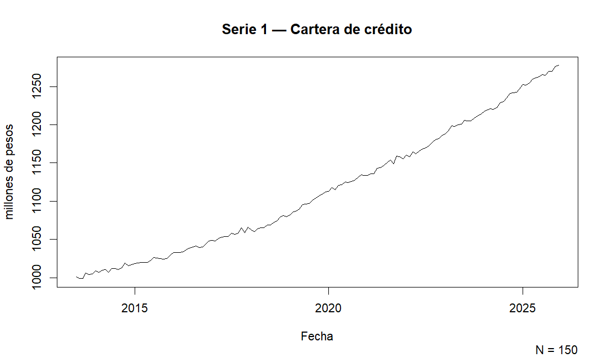{fig-alt="Cartera de crédito mensual"}

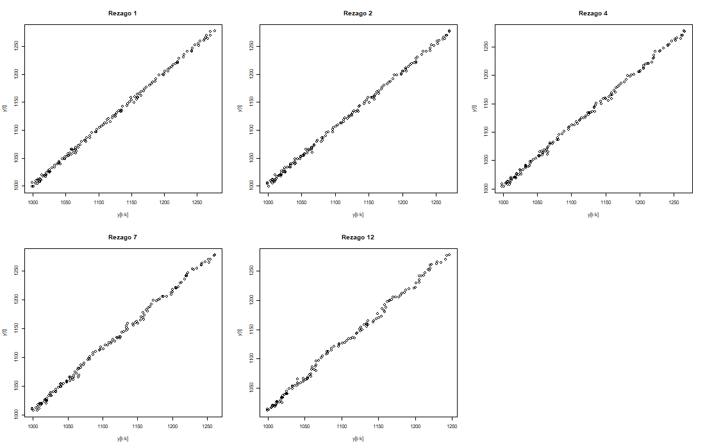{fig-alt="Gráficos de rezagos de cartera"}

La serie presenta una tendencia creciente sostenida. La amplitud de las medias por mes calendario es pequeña en relación con la tendencia y la evidencia exploratoria no respalda estacionalidad anual: tras retirar una tendencia lineal, la comparación descriptiva de medias por mes da F = `r fmt(est$F_anova_sobre_residuo_lineal[est$serie==1])` y p = `r fp(est$p_valor[est$serie==1])`. Se considera el período 12 como candidato de contraste, no como un hecho establecido.

## Serie 2: primas emitidas

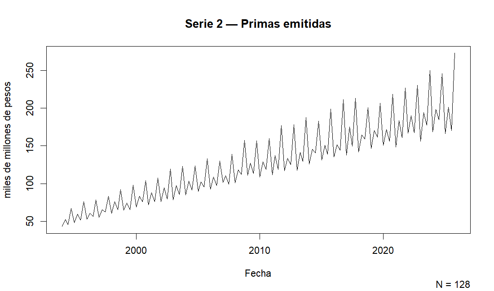{fig-alt="Primas trimestrales emitidas"}

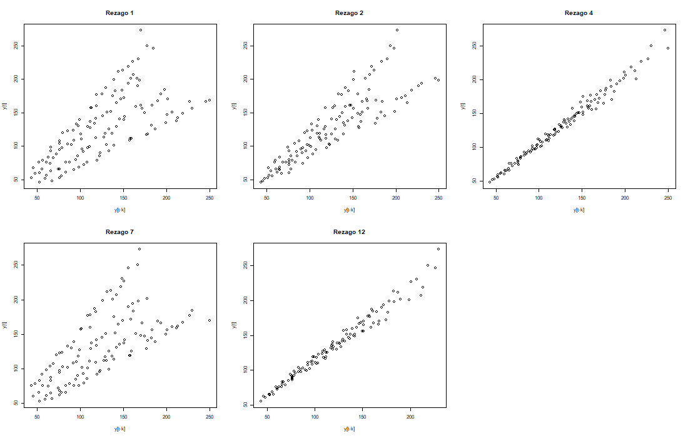{fig-alt="Gráficos de rezagos de primas"}

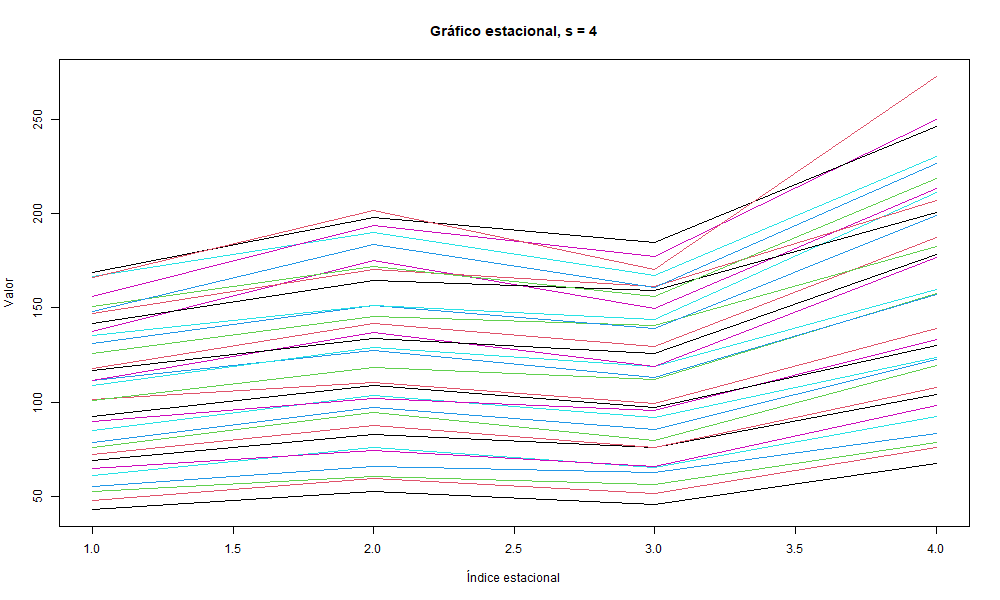{fig-alt="Perfil estacional trimestral"}

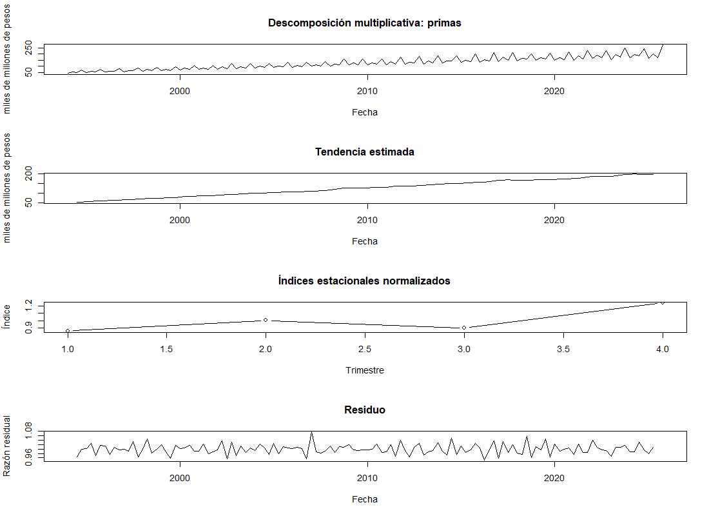{fig-alt="Descomposición clásica multiplicativa de primas"}

La serie muestra crecimiento de nivel y diferencias entre trimestres. Para el período candidato 4, la amplitud de las medias trimestrales es `r fmt(est$amplitud_medias[est$serie==2])` miles de millones; después de retirar tendencia lineal, el diagnóstico exploratorio arroja F = `r fmt(est$F_anova_sobre_residuo_lineal[est$serie==2])` y p = `r fp(est$p_valor[est$serie==2])`. La estructura estacional es consistente con un patrón multiplicativo; se usa una descomposición clásica manual con media móvil centrada, índices estacionales normalizados y residuo.

## Serie 3: rechazos diarios

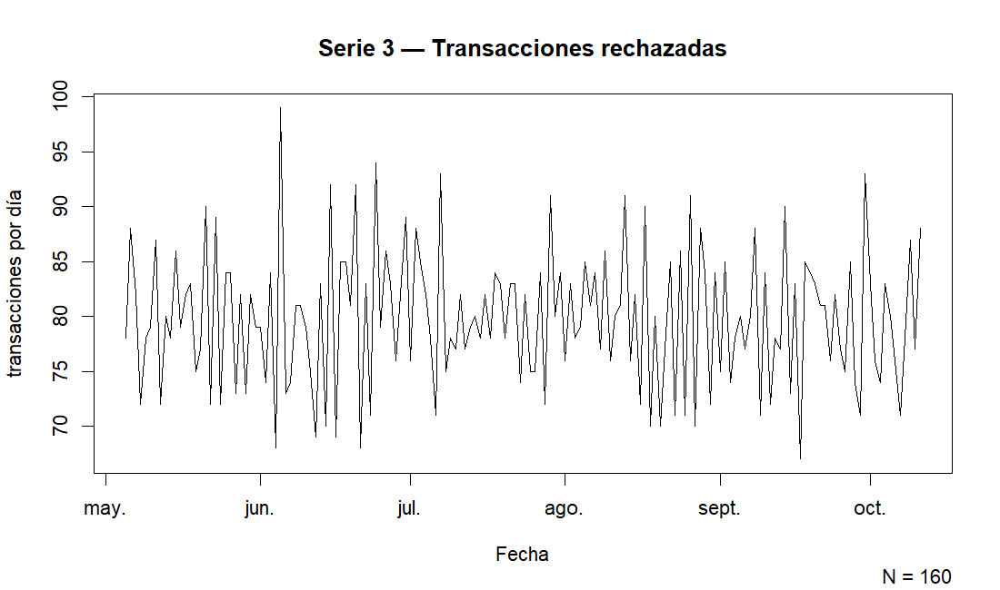{fig-alt="Transacciones rechazadas por día"}

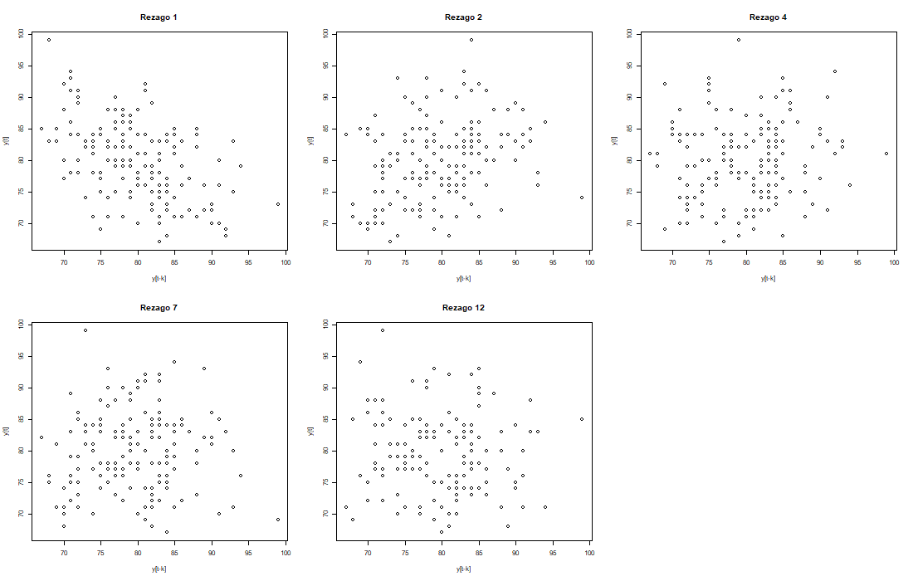{fig-alt="Gráficos de rezagos de rechazos"}

No se atribuye estacionalidad semanal solo por haber probado el período 7. La amplitud de las medias por día de semana es `r fmt(est$amplitud_medias[est$serie==3])` transacciones y la comparación exploratoria después de retirar tendencia lineal da F = `r fmt(est$F_anova_sobre_residuo_lineal[est$serie==3])` y p = `r fp(est$p_valor[est$serie==3])`. La serie oscila alrededor de un nivel aproximadamente estable, con dependencia negativa marcada en el primer rezago.

# Operador de rezago

## Candidatas, polinomios y raíces

```{r}
trans <- read.csv("../analisis/transformaciones-candidatas.csv",stringsAsFactors=FALSE)
print(trans,row.names=FALSE)
raices <- read.csv("../analisis/raices-operadores.csv",stringsAsFactors=FALSE)
print(subset(raices,(serie==1 & candidata=="Diferencia regular") | (serie==2 & candidata=="Diferencia estacional")),row.names=FALSE)
```

Para la serie 1 se prioriza la primera diferencia, (1-B), con raíz 1: elimina el componente de tendencia de primer orden sin aplicar una segunda diferencia que eleva la varianza y hace más negativa la autocorrelación de orden uno. La media de la primera diferencia es `r fmt(dep$media[dep$serie==1])` millones de pesos por mes; aún se aprecia cierto aumento entre bloques, de modo que la estacionariedad se considera aproximada y el pronóstico en niveles debe admitir una tendencia determinista.

Para la serie 2 se utiliza ( (1-B\^4)\log(Y_t) ). El logaritmo convierte un patrón multiplicativo en aditivo y la diferencia estacional elimina la estructura que se repite cada cuatro trimestres. El polinomio (1-B\^4) tiene raíces 1, −1, i y −i, todas de módulo uno; la raíz 1 corresponde al componente de nivel y las restantes raíces de unidad representan el ciclo estacional. No se aplica además una diferencia regular porque genera autocorrelación negativa fuerte y aumenta la varianza de la transformación.

Para la serie 3 se conserva la serie original. Las medias y varianzas por bloques son parecidas y no se observa tendencia o estacionalidad semanal suficientemente clara para justificar diferenciar. Aplicar diferencias elevaría la varianza y produciría una autocorrelación de orden uno más negativa.

## No sobrediferenciar

La identidad de referencia es

\[ \operatorname{Var}(Y_t-Y\_{t-1})=2\gamma(0)-2\gamma(1). \]

En una serie estacionaria con correlación positiva, la primera diferencia puede reducir varianza; al diferenciar una serie ya estacionaria, suele aparecer una correlación negativa artificial en el primer rezago y la varianza puede aumentar. En la serie 1 la varianza de la primera diferencia es `r fmt(trans$varianza[trans$serie==1 & trans$candidata=="Diferencia regular"])`; la segunda diferencia tiene varianza `r fmt(trans$varianza[trans$serie==1 & trans$candidata=="Combinada"])` en la tabla de candidatas. En la serie 2, la diferencia estacional sobre escala logarítmica tiene varianza `r fmt(trans$varianza[trans$serie==2 & trans$candidata=="Log + diferencia estacional"])` y r₁ = `r fmt(trans$r1[trans$serie==2 & trans$candidata=="Log + diferencia estacional"])`; combinarla con diferencia regular lleva r₁ a `r fmt(trans$r1[trans$serie==2 & trans$candidata=="Combinada"])`. En la serie 3, la serie original tiene varianza `r fmt(trans$varianza[trans$serie==3 & trans$candidata=="Original"])` y r₁ = `r fmt(trans$r1[trans$serie==3 & trans$candidata=="Original"])`; diferenciarla aumenta la varianza.

## Demostraciones de ecuaciones en diferencias

**Holt.** Para h ≥ 3, el pronóstico es (\widehat Y\_{T+h}=L_T+\widehat T_T h), una función afín de h. Su segunda diferencia es cero, por lo que ( (1-B)\^2\widehat Y\_{T+h}=0 ). La ecuación característica ( (1-z)\^2=0 ) tiene raíz 1 doble, asociada a la tendencia lineal. La solución general es (a+bh).

**Holt–Winters aditivo.** Para h ≥ s + 2, el componente estacional repetido se puede escribir como una función de período s y el nivel/tendencia como una función afín. El operador ( (1-B)(1-B\^s) ) elimina ambos componentes: ( (1-B\^s) ) anula la parte periódica y la diferencia restante anula la tendencia. El polinomio característico es ( (1-z)(1-z\^s) ). Sus raíces son las raíces s-ésimas de la unidad; la raíz 1 tiene multiplicidad dos, y las demás raíces de unidad corresponden a la estacionalidad. La solución general es la suma de una tendencia afín y una combinación periódica de período s.

# Dependencia y estacionariedad

Las figuras muestran ACF y PACF de la transformación elegida. La banda puntual de ruido blanco es (\pm1,96/\sqrt{n}); la banda de Bartlett para el rezago k usa (\pm1,96\sqrt{(1+2\sum_{j=1}^{k-1}r_j^2)/n}). La primera sirve como referencia si la serie fuera ruido blanco; la segunda incorpora la dependencia ya observada y ayuda a evaluar si una autocorrelación adicional destaca frente a una estructura correlacionada.

{fig-alt="ACF y PACF de la primera diferencia de la cartera"}

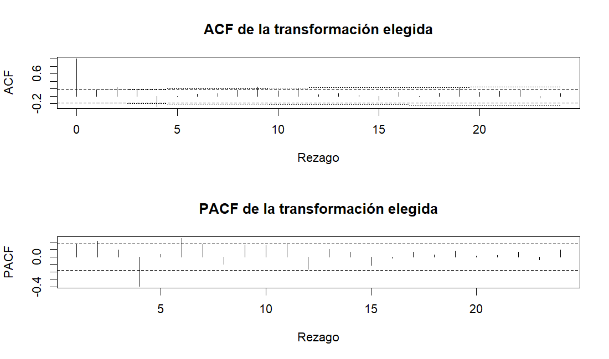{fig-alt="ACF y PACF de la diferencia estacional del logaritmo de primas"}

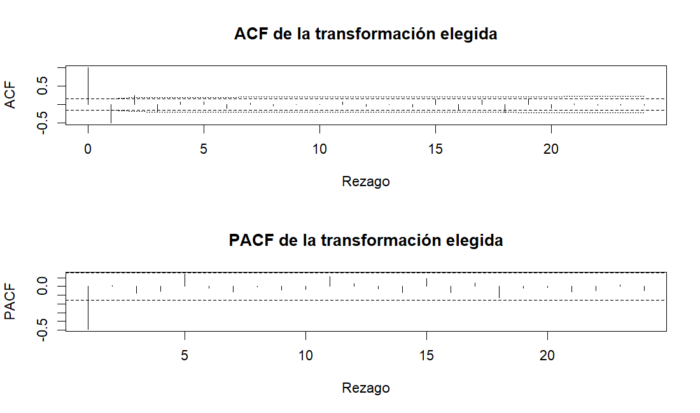{fig-alt="ACF y PACF de rechazos diarios sin transformar"}

## Ljung–Box: prueba conjunta de ausencia de autocorrelación

En cada serie, (H_0:r_1=\cdots=r\_{24}=0) frente a (H_1:) al menos una de esas autocorrelaciones es distinta de cero. El estadístico es (Q=n(n+2)\sum*{k=1}^{24}r_k^2/(n-k)), que bajo la nula se aproxima a una (\*\chi\^2{24}). Al 5 %, la región de rechazo es (Q\>36,415). La tabla entrega el estadístico y el valor p; se rechaza la nula en las tres series, lo que indica dependencia remanente y no ruido blanco.

```{r}
dep <- read.csv("../analisis/dependencia-transformada.csv")
print(dep[,c("serie","n","media","varianza","r1","m","LB_Q","LB_gl","LB_p")],row.names=FALSE)
```

-   **Serie 1:** Q = `r fmt(dep$LB_Q[dep$serie==1])`, p = `r fp(dep$LB_p[dep$serie==1])`. Se rechaza la ausencia conjunta de autocorrelación en las primeras 24 diferencias; la dependencia de corto plazo no desaparece al diferenciar.
-   **Serie 2:** Q = `r fmt(dep$LB_Q[dep$serie==2])`, p = `r fp(dep$LB_p[dep$serie==2])`. Se rechaza la ausencia conjunta; la transformación reduce la tendencia y la estacionalidad, pero queda estructura correlacionada.
-   **Serie 3:** Q = `r fmt(dep$LB_Q[dep$serie==3])`, p = `r fp(dep$LB_p[dep$serie==3])`. Se rechaza la ausencia conjunta en los rechazos diarios; la fuerte autocorrelación negativa del primer rezago es incompatible con ruido blanco, aunque la media y la varianza por bloques sean estables.

## Bloques e intervalos para la media

```{r}
bloques <- read.csv("../analisis/bloques-estacionariedad.csv")
print(bloques,row.names=FALSE)
print(dep[,c("serie","L","LRV_Bartlett","SE_ingenuo","IC_ingenuo_inf","IC_ingenuo_sup","SE_largo_plazo","IC_LP_inf","IC_LP_sup")],row.names=FALSE)
```

El intervalo ingenuo usa la varianza marginal dividida por n y trata las observaciones como si no hubiera dependencia. El intervalo de largo plazo usa la varianza de Bartlett con (L=\lfloor4(n/100)\^{2/9}\rfloor=4), por lo que reconoce la covarianza serial. El intervalo adecuado para una media de proceso dependiente es el de largo plazo. En la serie 1 la media de la transformación representa el aumento mensual; en la serie 2 representa el cambio logarítmico entre trimestres homólogos; en la serie 3 representa el nivel medio de rechazos diarios.

# Pronóstico y evaluación

## Métodos y ajuste de parámetros

Se implementan y comparan los métodos del catálogo: media simple, ingenuo, ingenuo estacional, media móvil, suavizamiento exponencial simple, doble media móvil, tendencia lineal, cuadrática y exponencial, tendencia con ficticias estacionales, Holt, Holt–Winters aditivo y Holt–Winters multiplicativo. Se aplican como competencia común; la interpretación final debe privilegiar los métodos cuyos supuestos sean coherentes con el diagnóstico de cada serie.

Los parámetros se seleccionan minimizando el MSE de un paso solo en el tramo de entrenamiento. Las rejillas de ventanas y constantes se guardan en `analisis/curvas-MSE.csv`.

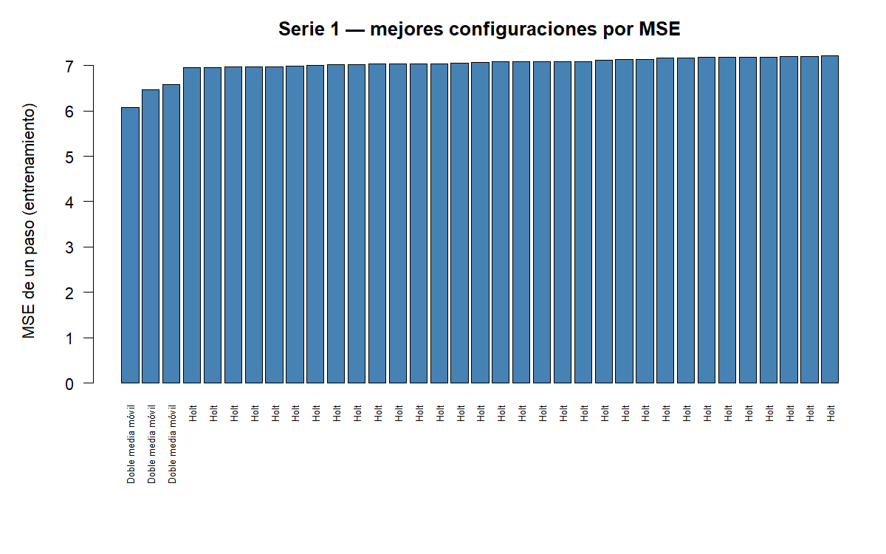{fig-alt="Curvas y mapas de MSE de los métodos ajustables para serie 1"}

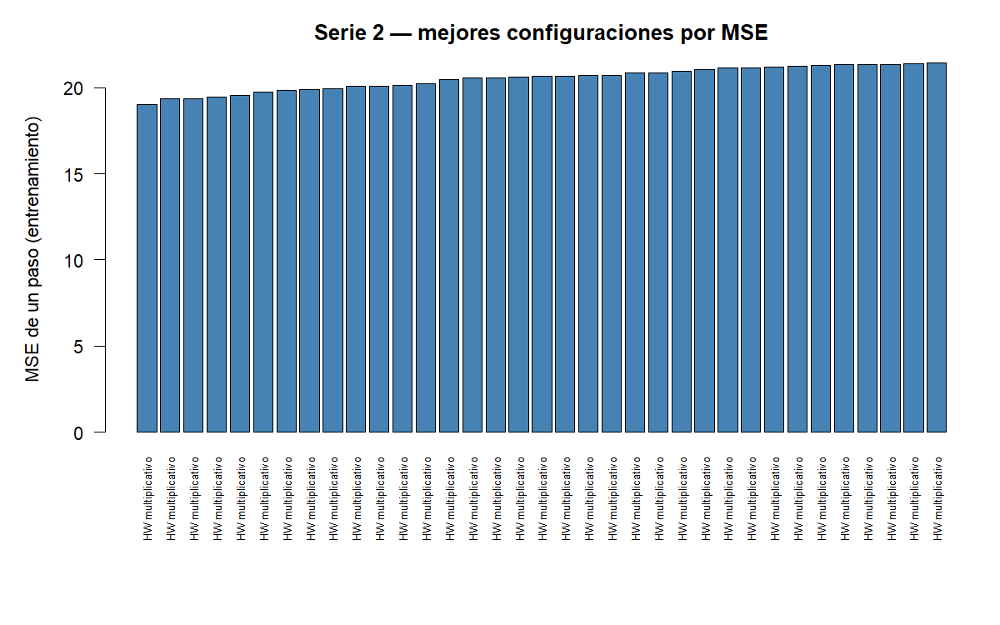{fig-alt="Curvas y mapas de MSE de los métodos ajustables para serie 2"}

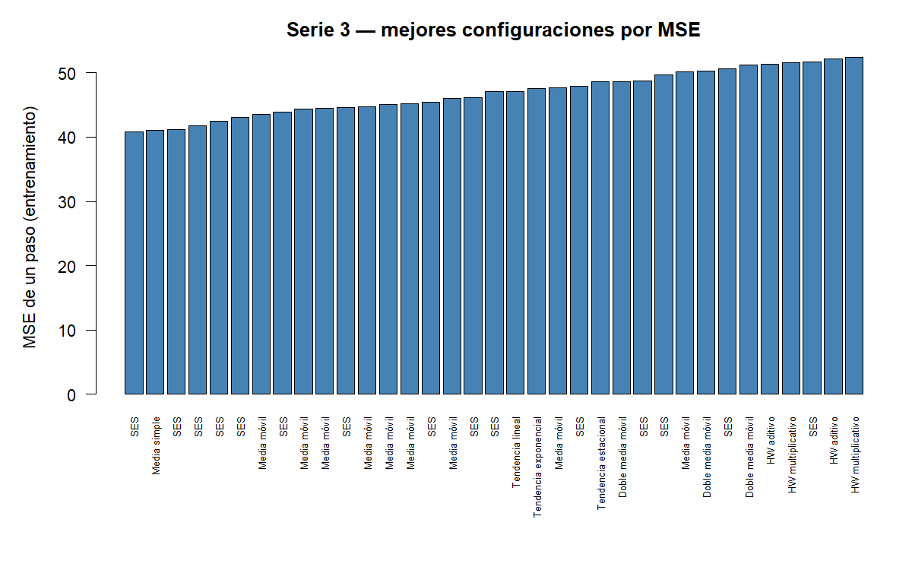{fig-alt="Curvas y mapas de MSE de los métodos ajustables para serie 3"}

## Evaluación de origen móvil

En h = 1 se usan orígenes n₀,…,T−1; en h = H, n₀,…,T−H. En cada origen, el método recibe únicamente el prefijo disponible y conserva los parámetros elegidos en entrenamiento. Se muestran RMSE, MAD y MAPE; el referente es ingenuo para las series 1 y 3, y estacional ingenuo para la serie 2, donde el ciclo trimestral tiene respaldo gráfico y numérico.

```{r}
for (i in 1:3) {
  cat("\n\n### Serie",i,"—",config[[i]]$nombre,"\n\n")
  for (hh in unique(c(1,config[[i]]$H))) {
    cat("\nHorizonte h =",hh,"\n\n")
    z <- subset(eval,serie==i & horizonte==hh); z <- z[order(z$RMSE),]
    print(z[,c("metodo","parametros","n","RMSE","MAD","MAPE")],row.names=FALSE)
  }
}
```

## Regresión y diagnósticos

El archivo `R/05-evaluacion.R` implementa MCO manual, error estándar ordinario, covarianza robusta tipo Bartlett, Jarque–Bera y Durbin–Watson. La función de MCO se contrasta con la regresión base en un bloque de verificación. Las tablas incluyen los cuatro diseños deterministas pedidos por serie; las cifras actuales son una referencia calculada independientemente y deben comprobarse al ejecutar R.

### Pruebas de coeficientes y diagnósticos de residuos

Para cada coeficiente de tendencia, la hipótesis es (H_0:\beta\_j=0) frente a (H_1:\beta*j\ne0). El estadístico es (t=\widehat\beta*j/SE{HAC}(\widehat\beta*j)), con aproximación (t\*{n-p}); al 5 %, se rechaza si (\|t\|\>t{0,975;n-p}). La tabla informa estimación, error estándar ordinario, error robusto, t, p y decisión; la lectura depende del signo, la unidad y el modelo.

Para los residuos, Ljung–Box contrasta (H_0:r_1=\cdots=r_m=0) frente a la alternativa de alguna autocorrelación no nula, con (Q) aproximadamente (\chi\^2_m); para m = 24, el valor crítico al 5 % es (\chi\^2\_{24;0,95}=36,415). Jarque–Bera contrasta simetría y curtosis normales mediante (JB=n(S^2/6+(K-3)^2/24)), aproximadamente (\chi\^2_2), con crítico 5,991. Durbin–Watson se usa como diagnóstico y se lee con (d\approx2(1-r_1)), no como sustituto de la ACF.

```{r}
regcoef <- read.csv("../analisis/regresiones-coeficientes.csv",stringsAsFactors=FALSE)
regdiag <- read.csv("../analisis/regresiones-diagnosticos.csv",stringsAsFactors=FALSE)
print(regcoef,row.names=FALSE)
print(regdiag,row.names=FALSE)
```

Las tablas deben interpretarse modelo por modelo: un coeficiente significativo no implica que los residuos sean ruido blanco; cuando Ljung–Box rechaza, la tendencia determinista no ha capturado toda la dependencia. Las pruebas de normalidad son diagnósticos de forma de distribución, y Durbin–Watson resume principalmente dependencia de primer orden.

## Validación del ganador a un paso

La validación se realiza sobre errores de origen móvil, no sobre residuos del ajuste final. La prueba t evalúa media cero; Ljung–Box evalúa autocorrelaciones hasta m = min(floor(n/4),24); Jarque–Bera contrasta asimetría y curtosis; Durbin–Watson se lee junto con (d\approx2(1-r_1)).

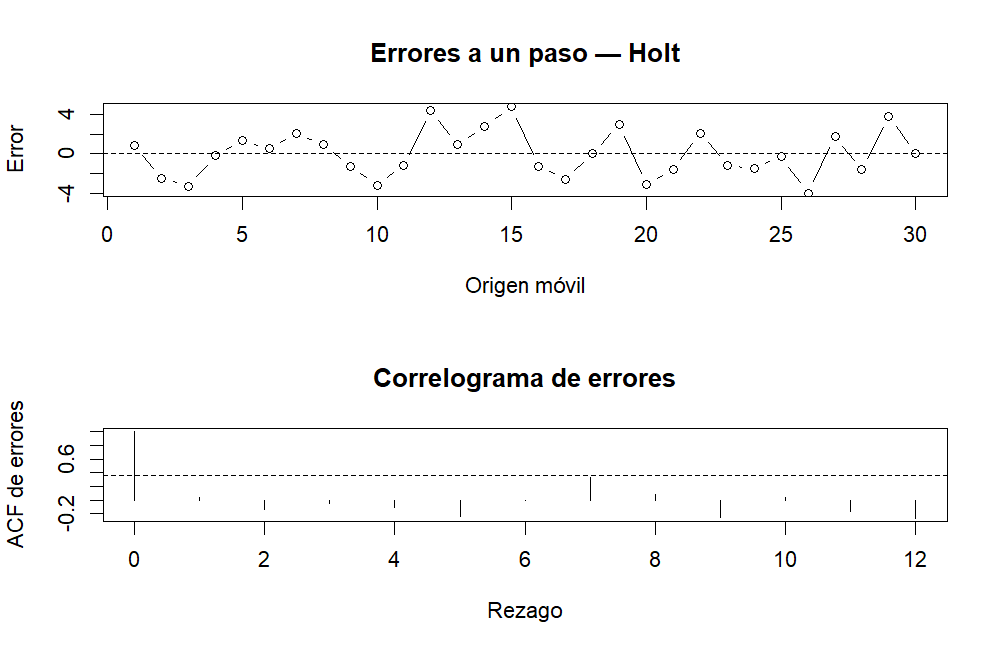{fig-alt="Errores de origen móvil y ACF del ganador a un paso de la serie 1"}

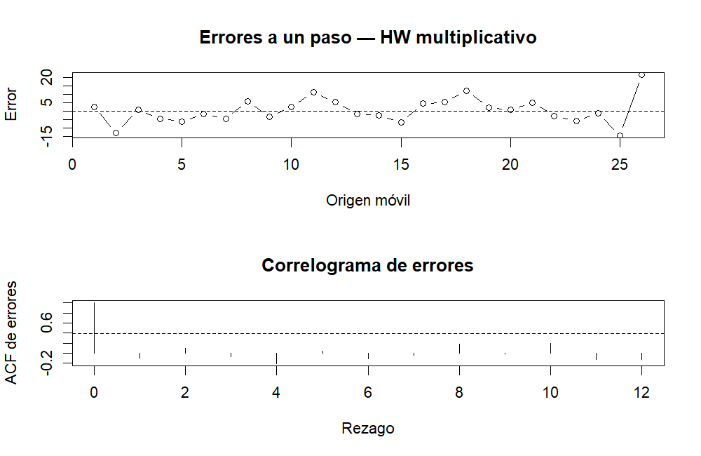{fig-alt="Errores de origen móvil y ACF del ganador a un paso de la serie 2"}

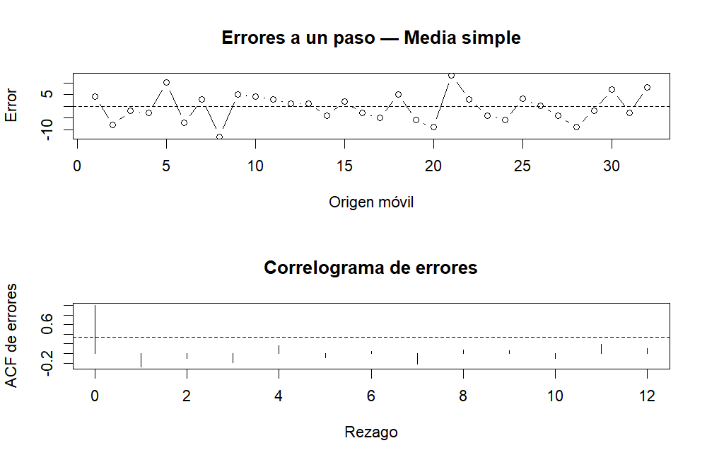{fig-alt="Errores de origen móvil y ACF del ganador a un paso de la serie 3"}

```{r}
val <- read.csv("../analisis/validacion-errores.csv")
print(val,row.names=FALSE)
```

En la tabla se reportan la media de los errores, la prueba t de media cero, Ljung–Box, Jarque–Bera y Durbin–Watson para los ganadores a un paso. La decisión formal debe verificarse con la salida R final; no se deben interpretar los valores p sin consignar hipótesis, estadístico, distribución, región crítica y lectura operativa.

## Pronóstico final y banda heurística

El método que minimiza RMSE en el horizonte de decisión se reajusta con toda la serie. La banda se construye como pronóstico ± 1,96 desviaciones estándar de los errores de origen móvil para cada horizonte; es una referencia heurística, no una garantía probabilística formal.

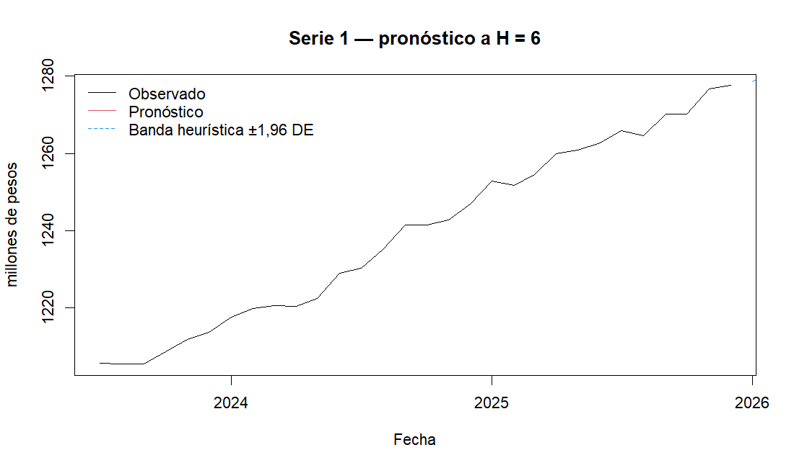{fig-alt="Pronóstico de cartera para seis meses"}

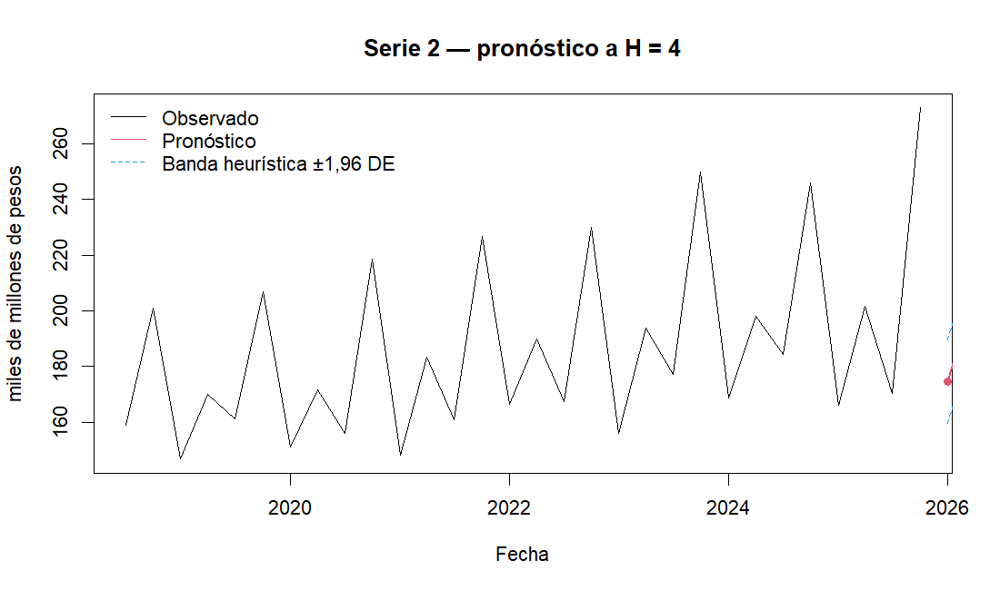{fig-alt="Pronóstico de primas para cuatro trimestres"}

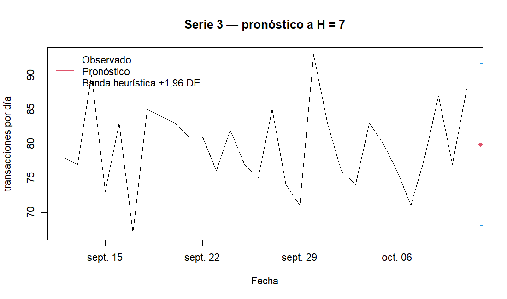{fig-alt="Pronóstico de rechazos para siete días"}

```{r}
print(pron,row.names=FALSE)
```

# Conclusión técnica

**Serie 1.** La cartera tiene tendencia creciente y no se encuentra evidencia convincente de estacionalidad anual. La primera diferencia reduce el crecimiento a una variación media de `r fmt(dep$media[dep$serie==1])` millones por mes, aunque queda dependencia (Ljung–Box p = `r fp(dep$LB_p[dep$serie==1])`). En el origen móvil, `r bestrow(1,1)$metodo` gana a un paso con RMSE `r fmt(bestrow(1,1)$RMSE)` frente a `r fmt(refrow(1,1,"Ingenuo")$RMSE)` del ingenuo; para seis meses gana `r bestrow(1,6)$metodo` con RMSE `r fmt(bestrow(1,6)$RMSE)` frente a `r fmt(refrow(1,6,"Ingenuo")$RMSE)` del ingenuo. Para decisiones de fondeo, el ganador a seis meses es la referencia principal.

**Serie 2.** Las primas presentan tendencia y patrón trimestral marcado. La transformación logarítmica con diferencia estacional de cuatro trimestres reduce la variación de escala; permanece dependencia (Ljung–Box p = `r fp(dep$LB_p[dep$serie==2])`). `r bestrow(2,1)$metodo` es el ganador a un paso (RMSE `r fmt(bestrow(2,1)$RMSE)` frente a `r fmt(refrow(2,1,"Ingenuo estacional")$RMSE)` del ingenuo estacional) y a cuatro pasos (RMSE `r fmt(bestrow(2,4)$RMSE)` frente a `r fmt(refrow(2,4,"Ingenuo estacional")$RMSE)`). El patrón estacional aporta información que una tendencia lineal no recoge.

**Serie 3.** Los rechazos fluctúan alrededor de `r fmt(particion$media[particion$serie==3])` transacciones diarias; las medias y varianzas por bloques son relativamente estables, aunque el primer rezago es `r fmt(dep$r1[dep$serie==3])` y Ljung–Box rechaza ruido blanco. `r bestrow(3,1)$metodo` gana en h = 1 (RMSE `r fmt(bestrow(3,1)$RMSE)` frente a `r fmt(refrow(3,1,"Ingenuo")$RMSE)` del ingenuo) y en h = 7 (RMSE `r fmt(bestrow(3,7)$RMSE)` frente a `r fmt(refrow(3,7,"Ingenuo")$RMSE)`). Este método da una base estable, pero no modela la dependencia negativa de corto plazo.

**Comparación.** Un método puede ganar en una serie y perder en otra porque la cartera requiere extrapolar una tendencia, las primas requieren reproducir un ciclo anual multiplicativo y los rechazos no muestran un ciclo semanal suficiente para justificar un método estacional. La decisión final debe actualizarse si cambian el proceso operativo, la tendencia o el patrón estacional.

# Argumentos para los interesados

## Mapa de interesados y costos

| Serie | Interesados y decisión | Error por exceso | Error por defecto |
|------------------|------------------|------------------|------------------|
| 1 | Gerencia financiera: negociar fondeo; consejo: vigilar liquidez; asociados: disponibilidad de crédito. | Recursos ociosos y costo financiero; el contexto no cuantifica la tasa. | Fondeo insuficiente, colocación frenada y solicitudes no atendidas; costo no cuantificado en el contexto. |
| 2 | Junta: metas trimestrales; comercial: distribuir objetivos; supervisor/finanzas: reservas. | Reservas superiores a las necesarias y metas difíciles; el contexto no cuantifica el costo. | Reservas insuficientes y riesgo de sanciones; monto no cuantificado. |
| 3 | Riesgo: turnos diarios; analistas: capacidad; comercios y compradores: revisión oportuna. | Cada turno sobrante cuesta \$380.000. | Un turno faltante equivale a 20 casos sin capacidad de revisión y hasta \$3.000.000 en compras perdidas bajo el supuesto del contexto. |

## Argumentos en cinco partes

### Serie 1 — Fondeo de cartera

-   **Afirmación:** planear un fondeo creciente durante los próximos seis meses usando la tendencia cuadrática como referencia inicial.
-   **Evidencia:** el pronóstico a seis meses va aproximadamente de `r fmt(pron$pronostico[pron$serie==1][1],1)` a `r fmt(tail(pron$pronostico[pron$serie==1],1),1)` millones; su RMSE móvil es `r fmt(bestrow(1,6)$RMSE)` millones, frente a `r fmt(refrow(1,6,"Ingenuo")$RMSE)` millones del método ingenuo.
-   **Justificación:** el modelo recoge la aceleración de la cartera mejor que mantener fijo el último saldo.
-   **Alcance:** la recomendación cubre seis meses bajo la continuidad del patrón observado; debe revisarse ante cambios en tasas, originación, mora o políticas de crédito.
-   **Objeción:** “¿Garantiza que no falte fondeo?” No. La desviación típica de errores por horizonte aumenta aproximadamente de 2,34 a 2,68 millones y la banda es heurística; conviene mantener margen de liquidez.

### Serie 2 — Metas y reservas de primas

-   **Afirmación:** usar Holt–Winters multiplicativo para fijar metas trimestrales preliminares y calcular reservas proporcionales.
-   **Evidencia:** los pronósticos para 2026 son aproximadamente `r paste(fmt(pron$pronostico[pron$serie==2],1),collapse="; ")` miles de millones, con RMSE a cuatro pasos de `r fmt(bestrow(2,4)$RMSE)` frente a `r fmt(refrow(2,4,"Ingenuo estacional")$RMSE)` del ingenuo estacional.
-   **Justificación:** el método combina la evolución del nivel con el patrón trimestral que se observa en la historia.
-   **Alcance:** aplica si se mantienen el calendario comercial, la mezcla de ramos y las reglas de reservas; una reforma o cambio de productos exige actualizarlo.
-   **Objeción:** “¿Podemos fijar la reserva exacta con estas cifras?” No; el error de origen móvil es de varios miles de millones y el pronóstico no sustituye las reglas prudenciales.

### Serie 3 — Programación de turnos

-   **Afirmación:** usar 79,8 rechazos diarios como referencia de carga y convertirla en turnos con margen operativo.
-   **Evidencia:** el RMSE a siete días es `r fmt(bestrow(3,7)$RMSE)` rechazos/día frente a `r fmt(refrow(3,7,"Ingenuo")$RMSE)` del ingenuo; un turno cubre 20 casos.
-   **Justificación:** el promedio evita reaccionar en exceso a cada fluctuación diaria; 79,8 casos equivalen a casi cuatro turnos de capacidad nominal.
-   **Alcance:** aplica a la semana siguiente y al supuesto de 20 revisiones por turno; debe actualizarse ante alertas antifraude, campañas o cambios en comercios.
-   **Objeción:** “¿Es más barato dejar un turno faltante que uno sobrante?” Bajo los supuestos del caso, el exceso cuesta \$380.000 y el defecto puede asociarse con \$3.000.000 en compras perdidas por turno faltante; el costo asimétrico favorece un margen de capacidad, sin convertir el pronóstico en garantía.

## Nota ejecutiva

La nota de una página se adjunta en `nota-interesados.pdf`. Presenta una figura por serie, el método de referencia, el error esperado y los límites de interpretación.

# Reproducibilidad, uso de IA y auditoría

Desde la raíz del repositorio, con R 4.3 o posterior:

``` r
source("analisis/correr-todo.R")
```

Después:

``` sh
quarto render informe/informe.qmd
```

**Uso de IA.** Se solicitó ayuda para estructurar el repositorio, implementar métodos y diagnósticos, comparar los modelos y redactar el informe. Se recibió código inicial, tablas, figuras y borradores. .
